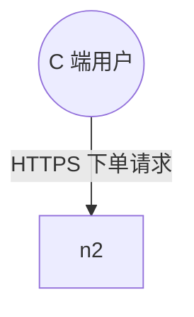

# 多格式导出与二次编辑指南

## 一、可编辑文件（二次修改首选）

### .drawio（推荐）

| 打开方式 | 说明 |
|----------|------|
| 网页版 | 打开 <https://app.diagrams.net> → 文件 → 打开自 → 设备，选择 `.drawio` |
| 桌面版 | draw.io Desktop 直接双击打开 |
| VS Code | 安装 **Draw.io Integration** 插件，直接点开文件 |
| Confluence / Notion | 支持导入 drawio 文件并可在线编辑 |

**二次修改能做什么**
- 拖拽节点、改连线走向、增删图元
- 右侧「格式面板」改配色、边框、字体
- 双击分组标题改边界名
- 拖动节点时连线自动跟随（已设置 exit/entry 端口）

**导入到 Word / PPT**
- drawio 桌面版：文件 → 导出为 → PNG / SVG，再插入 Office
- 或安装 drawio 的 Office 插件直接嵌入可编辑对象

### .excalidraw

| 打开方式 | 说明 |
|----------|------|
| 网页版 | <https://excalidraw.com> → Open（左上角菜单）→ 选择 `.excalidraw` |
| VS Code | 安装 **Excalidraw** 插件 |
| Obsidian | 安装 Excalidraw 插件后可直接打开 |

**特点**：手绘风格，适合方案评审、头脑风暴。元素已做文本绑定，拖动图形文字跟随。

**已知限制**
- Excalidraw 无圆柱（数据库）图元，本技能用矩形替代，语义靠文字体现
- 无父子容器概念，分组框是视觉边界（拖动分组框不会带动内部节点）

---

## 二、结构化文本（嵌文档 / 进 Git）

### Mermaid（.mmd）

**嵌入 Markdown**
````markdown

````
GitHub、GitLab、语雀、飞书文档、Notion、VS Code（装 Markdown Preview Mermaid Support）均支持直接渲染。

**进 Git 版本管理**
- `.mmd` 是纯文本，diff 可读性极好：改一个节点就是改一行
- 建议与文档同仓存放，如 `docs/diagrams/order-arch.mmd`

**渲染校验**
```bash
npx -y @mermaid-js/mermaid-cli -i order.mmd -o order.png   # 需 Node + Chromium
```

### PlantUML（.puml）

适合内网环境或已有 PlantUML 工具链的团队。

```bash
java -jar plantuml.jar order.puml          # 生成 PNG
java -jar plantuml.jar -tsvg order.puml    # 生成 SVG
```
VS Code 装 PlantUML 插件后可实时预览（Alt+D）。

**已知限制**：PlantUML 活动图对复杂嵌套分支表达有限，流程图的完整分支以 drawio / Mermaid 产物为准（脚本已在文件头标注）。

---

## 三、静态图（汇报 / PPT / 邮件）

### SVG（本技能自渲染，零依赖）

- 矢量、任意缩放不失真，PPT 插入后放大不糊
- 可直接拖进浏览器查看，也可内嵌到 HTML
- **已知限制**：字体宽度按估算（中文全角/西文半角），极长标签可能溢出；生成后可用 drawio 微调

### PNG 转换命令

| 来源 | 命令 |
|------|------|
| 从 Mermaid | `npx -y @mermaid-js/mermaid-cli -i order.mmd -o order.png -w 1600` |
| 从 drawio | drawio 桌面版：文件 → 导出为 → PNG（可勾选"透明背景""缩放 200%"） |
| 从 SVG | drawio 网页版导入 SVG 后导出 PNG；或用 Inkscape：`inkscape order.svg -o order.png -w 1600` |

> 本技能**不代跑**上述命令——PNG 渲染需要 Node + Chromium 或外部工具，环境差异大。脚本只给命令，由你在本地执行。

---

## 四、交付组合建议

| 场景 | 交付 |
|------|------|
| 写进需求文档 / README | Mermaid 文本（嵌 Markdown） |
| 方案评审，要现场改 | `.drawio` |
| 头脑风暴 / 草图讨论 | `.excalidraw` |
| PPT 汇报 | SVG（或 PNG @2x） |
| 发给客户，对方要能改 | `.drawio` + SVG 各一份 |
| 长期维护、多人协作 | `graph.json`（改模型重生成）+ Mermaid（进 Git） |

**最稳的组合**：`graph.json` + `.drawio` + Mermaid 三件套。要改图就改 `graph.json` 重新生成，四种产物自动同步；临时微调直接在 drawio 里改。

---

## 五、改图后如何保持四格式同步

**正确做法**：改 `graph.json` → 重跑四个脚本 → 全部产物同步更新。

**错误做法**：在 drawio 里改完，再手动去改 Mermaid —— 必然不一致。

若已在 drawio 做了大量手工调整且不想重来，就把改动点回填到 `graph.json`（改节点 label / 增删连线），再重新生成并检查差异。
